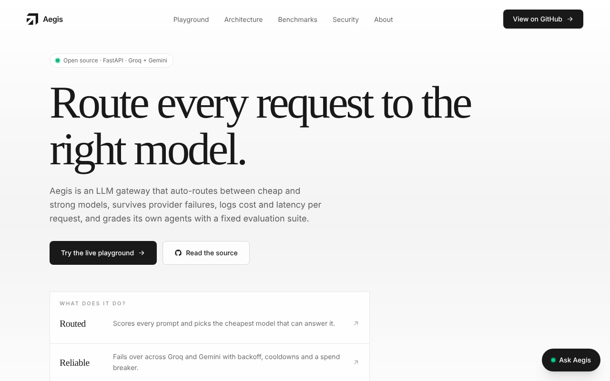
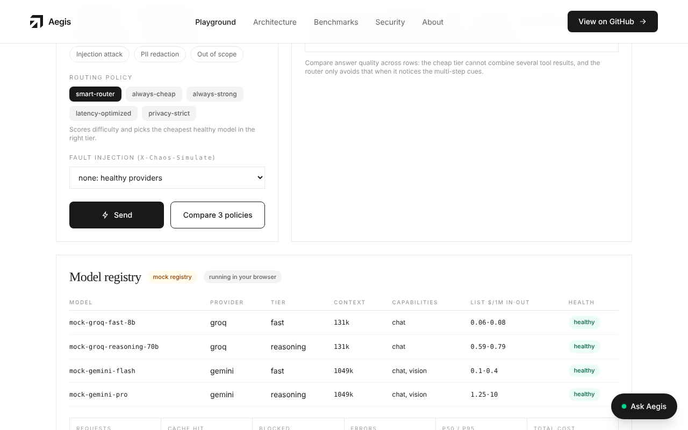
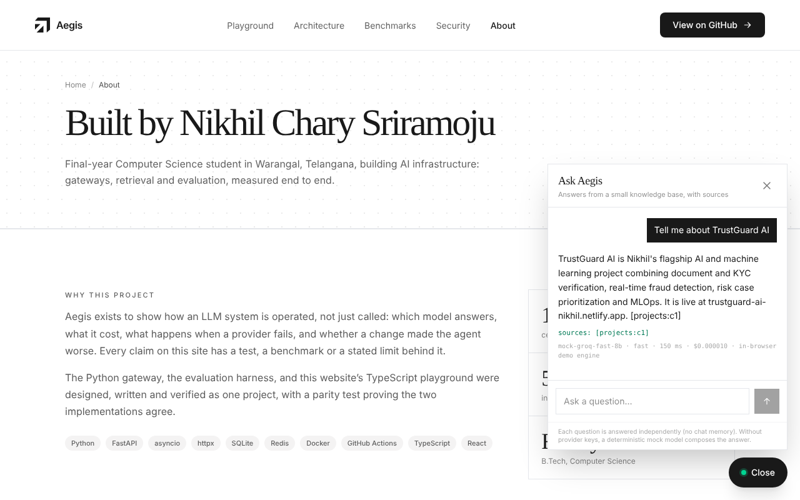

# Aegis AI Gateway

**Auto-routing, LLMOps and agent evals in one gateway.** A FastAPI service that sends each LLM request to the cheapest model that can answer it, fails over when a provider breaks, logs model, tokens, latency and cost for every call, and grades its own agent on a fixed 30-task exam that gates CI.

  



Repo layout: `gateway/` is the Python service and eval harness. `web/` is the website with a live playground, deployed on Vercel.

## Screenshots

| Playground: same prompt, three policies | Ask Aegis: cited answer from the knowledge base |
|---|---|
|  |  |

## What it does

```
client ──► Guard ──► Router ──► Cache ──► Provider (Groq / Gemini)
           │ inject    │ difficulty │ SHA-256     │ 429/5xx/timeout
           │ PII       │ score      │ exact       ▼
           │ rate/$    ▼            ▼          cooldown + next model
           └────────► SQLite request log (every outcome, incl. blocked)
```

| Area | What is implemented |
|---|---|
| Routing | Heuristic difficulty score (length, code, math, multi-step cues, JSON constraint) → fast or reasoning tier. Five policies: smart-router, always-cheap, always-strong, latency-optimized, privacy-strict. |
| Model discovery | Reads Groq and Gemini model lists at startup and every 10 min, classifies into tiers by name and capability. Falls back to a mock registry with no keys. |
| Reliability | 429 → 60 s cooldown, 5xx/timeout → 30 s. Full-jitter backoff, max 4 attempts, first fallback prefers another provider. |
| LLMOps | SQLite log of model, tokens, latency, cost, status and trace. Exact-match cache (memory or Redis). Daily spend breaker. `/v1/metrics` with p50/p95. |
| Security | Injection firewall, PII redaction before routing/cache/logging, sliding-window rate limit, optional API key (constant-time compare), AST-allow-listed calculator (no `eval`). |
| Agent | Planner → security check → tools (calculator, hybrid RAG, telemetry) → verifier → synthesizer. Max 5 steps; refuses with "Insufficient grounded context" below the retrieval threshold. |
| Retrieval | BM25 + hashed char-trigram vectors, fused with reciprocal rank fusion. |
| Learned router | `learned-router` policy: a character-level 1-D CNN (about 4.2k parameters, NumPy, hand-written backprop) predicting whether a prompt needs the strong tier. Prototype trained on synthetic labelled prompts (`python -m evals.train_router`). |
| Observability | `GET /metrics` in Prometheus text format: request, block and error counters, cache hit ratio, p50/p95 latency, cost, requests per model, and per-model health (`aegis_model_up`). |
| Idempotency | `Idempotency-Key` header on `POST /v1/chat`: a retry with the same key and body replays the stored response with no second provider call; the same key with a different body returns 409. In-memory and per process. |
| MCP server | `python -m app.mcp_server` speaks the Model Context Protocol over stdio and exposes four tools (calculator, knowledge-base search, prompt analysis, gateway chat) to any MCP client. Tools only. |
| Assistant | "Ask Aegis" chat on the website: a bounded retrieval agent over a small knowledge base about the author and the gateway. Cites sources, refuses out-of-scope questions, answers through the gateway (Groq/Gemini when keys are set). |
| Evals | 30 tasks, three deterministic scorers (correctness, trajectory, compliance), CI gate on pass-rate drop and cost savings. |
| Chaos | `X-Chaos-Simulate: rate_limit \| timeout \| provider_500` fails the first model on demand. |

## Results (mock provider: synthetic)

| Policy | Pass rate | Cost (30 tasks) | p95 latency |
|---|---|---|---|
| always-cheap | 76.7% | $0.000142 | 260 ms |
| smart-router | 93.3% | $0.000542 | 450 ms |
| always-strong | 100% | $0.001815 | 900 ms |

Smart routing is 70.2% cheaper than always-strong and gives up 6.7 points of pass rate. It fails two multi-hop tasks that carry no wording cues (`hop-06`, `hop-07`). That weakness is left in on purpose.

> **These numbers come from a deterministic mock provider** whose fast-tier models can only combine one tool result. They make runs repeatable, not realistic. Do not put them on a resume. Run `--live` and use those.

## Run it

```bash
cd gateway
python -m venv .venv && source .venv/bin/activate
pip install -r requirements-dev.txt
pytest -q                                  # 87 tests
python -m evals.train_router               # retrain the CNN router + held-out report
python -m evals.benchmark                  # mock run + CI gate
cp .env.example .env                       # add GROQ_API_KEY / GEMINI_API_KEY (never commit .env)
python -m evals.benchmark --live           # real numbers for your resume
uvicorn app.main:app --reload              # http://localhost:8000/docs  (metrics at /metrics)
python -m app.mcp_server                   # MCP stdio server for Claude Desktop / IDE agents
docker compose up --build                  # gateway + redis
```

```bash
cd web
npm install
npm run dev          # build + serve at http://localhost:4173
npm test             # typecheck, Python/TS parity, assistant + API smoke tests, build, SEO and bundle audit
```

## Learned router (prototype)

| Router | Held-out accuracy | Recall on strong-tier prompts |
|---|---|---|
| keyword heuristic | 61.4% | 22.8% |
| character CNN | 91.5% | 96.6% |

Held-out means 1,000 synthetic prompts built from phrase pools disjoint from training, with no benchmark prompt in either set. Labels follow a documented definition (needs several facts combined or multi-step reasoning), so this shows the CNN learned structure, not that it is better on production traffic. On the 30-task mock benchmark it passes 96.7% and fixes both hidden multi-hop tasks but misses `hop-02` (the heuristic catches that one through its "first/next" cues). The router was built after the benchmark exposed that weakness, so treat that run as optimistic. Next step: a hybrid of both routers trained on real request logs.

## Resume bullet (fill X and Y from your own `--live` run)

> Built an LLM gateway (FastAPI, async, Groq + Gemini) that auto-routes requests between cheap and strong models and fails over on 429/5xx; on a 30-task agent eval, smart routing cut cost by **X%** versus always-strong while keeping pass rate within **Y** points, enforced as a CI gate.

Never type X or Y from a guess. They are in `gateway/artifacts/benchmark_report.md` after a live run.

## Interview questions this project answers

- **How does the router decide?** Difficulty = score/6 from six signals; ≥ 0.5 selects the reasoning tier; reasons are returned with every response.
- **How do you evaluate an agent?** Correctness, trajectory and compliance scorers; a task passes only if all three are 1.0; no LLM judge.
- **How is cost calculated? What about timeouts?** `tokens/1M × price` from the provider's usage field; provider calls time out at 15 s and count as a failover trigger.
- **Why not LiteLLM?** Use it in production. Here the point is to build and explain the mechanics.

## Honest scope

Implemented and tested: everything above except the items below. The CNN is a small prototype, not a production classifier. `gateway/tests/test_api.py` covers the FastAPI layer and skips itself when `fastapi`/`httpx` are not installed, so run `pytest` in a full environment before relying on it.

Not implemented: SSE streaming anywhere. The CNN router, MCP server, metrics and idempotency are Python-only (not in the website's TypeScript playground). Also missing: a Python endpoint for the assistant (it lives in the web functions), chat memory in the assistant, human-in-the-loop approval, SSE streaming, LangGraph runtime, PostgreSQL (SQLite is the store), shared rate limiter across replicas. The website playground runs a TypeScript port of the engine, verified against Python for identical model, tier, tools and cost on 90 task runs (`npm run parity`).

## Deploy

1. Push this repo to GitHub as `aegis-gateway`.
2. Vercel → Add New Project → import it → **Root Directory: `web`**. Build settings come from `web/vercel.json`.
3. Set `SITE_URL` (your final domain) and optional `GROQ_API_KEY`, `GEMINI_API_KEY`, `RESEND_API_KEY`, `CONTACT_TO_EMAIL`.
4. Deploy the Python gateway separately (Render, Fly.io or Railway) from `gateway/Dockerfile`.

MIT licensed.
